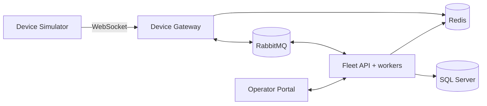

# Architecture

- **Device Gateway:** SignalR device hub, presence in Redis, admission control, relays messages to and from RabbitMQ. No SQL.
- **Fleet API:** REST + operator hub; Devices, Commands and Rollouts; hosted services for telemetry processing and rollout orchestration; Wolverine outbox.
- **Simulator:** virtual devices and measurements.
- **Portal:** React + TypeScript operator UI.
- **Infrastructure (containers via Aspire):** SQL Server, Redis, RabbitMQ.

